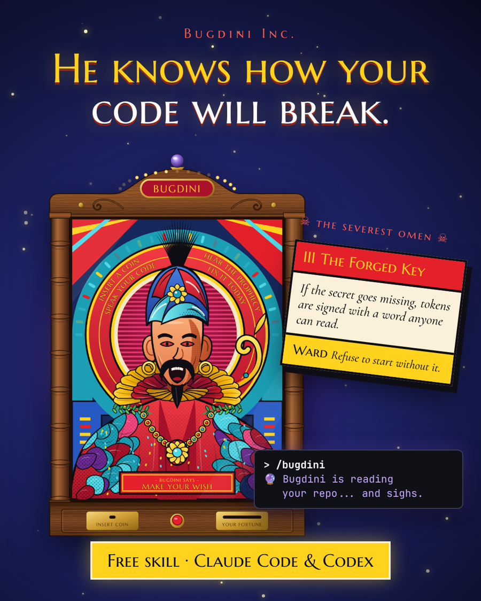
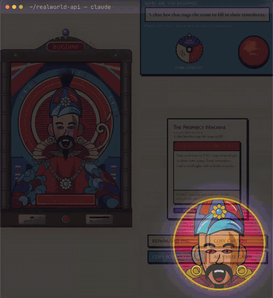
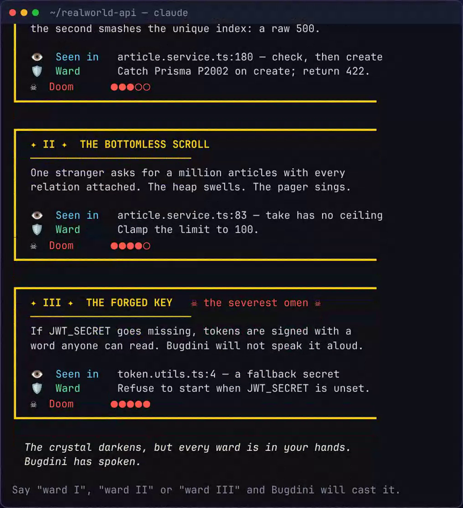
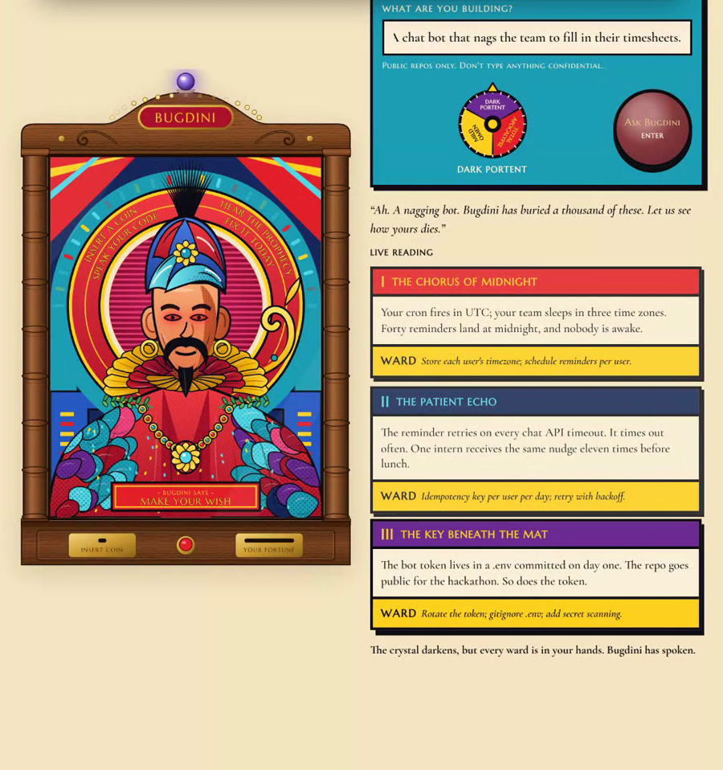

<p align="center"></p>

# 🔮 Bugdini

**A Zoltar-style fortune teller for your code, from Bugdini Inc.**

Bugdini is an agent skill for **Claude Code** and **Codex**. Ask him for a reading and he studies your repository, muttering as he goes, then deals three tarot cards right in your chat or terminal: three real ways your project will break in production, each with the file and line he saw it in, a one-line fix (a *ward*) and a doom rating. Say `ward II` and he casts the fix.

No UI, no web page, no setup. Just a coin, a crystal and some bad news.

<p align="center"></p>

Then he deals the cards. Every one cites a real file and line:

<p align="center"></p>

## Want him?

Paste this into Claude Code or Codex:

```text
Install the Bugdini skill from github.com/adelelousmith/bugdini, then read my fortune.
```

## Install

**Any agent, with the [skills CLI](https://github.com/vercel-labs/skills):**

```bash
npx skills add adelelousmith/bugdini
```

**Claude Code, as a plugin:**

```text
/plugin marketplace add adelelousmith/bugdini
/plugin install bugdini@bugdini
```

**Or by hand, for Claude Code and Codex at once:**

```bash
git clone https://github.com/adelelousmith/bugdini && ./bugdini/install.sh
```

Restart Claude Code or Codex after installing.

## Use

In any project:

| Say | What happens |
| --- | --- |
| `/bugdini` or "Bugdini, read my fortune" | A reading of the current repo (Dark Portent) |
| "Bugdini, mild" / "dark" / "total apocalypse" | Turns the doom dial: gentle, ominous or full melodrama |
| "Bugdini, I'm building a Slack bot that books rooms" | A reading of an idea, no code needed |
| `ward I`, `ward II`, `ward III` | Bugdini makes that fix, then runs your tests |

## What he looks for

Real, well-known production failures: missing timeouts and retries, check-then-write races, time zones and cron, unbounded queries, swallowed errors, committed or fallback secrets, missing rate limits, unverified webhooks, leaks and stale dependencies. The joke is the delivery; the warnings are real, and every card cites a line you can check.

## His rules

- **Read-only** until you ask for a ward. He never runs your project, installs anything or touches the network unless you ask.
- **Never prints secrets.** If he finds one he tells you where it lurks, not what it is.
- **Only cites lines he actually read.** If the evidence is thin, the omen says so.
- Teases the code, never the person, and drops the act the moment you ask a straight question.

## Where he came from

Bugdini started life as **The Prophecy Machine**, a fortune-teller booth built at a Claude Code Community workshop in Newcastle: insert a coin, tell him what you're building, turn the doom dial, and he reads three prophecy cards aloud. The skill brings the same fortunes to your own repo.

<p align="center"></p>

## Files

| Path | What it is |
| --- | --- |
| `skills/bugdini/SKILL.md` | The skill: Bugdini's character, the ritual and the rules |
| `skills/bugdini/references/deck.md` | The crystal header, thinking lines and card layout |
| `.claude-plugin/` | Lets Claude Code install it as a plugin |
| `install.sh` | Copies the skill into `~/.claude/skills` and `~/.codex/skills` |

## Licence

MIT. Bugdini is an original character. "Zoltar-style" describes the genre of coin-operated fortune-teller machines; this project isn't affiliated with any Zoltar machine or film.
